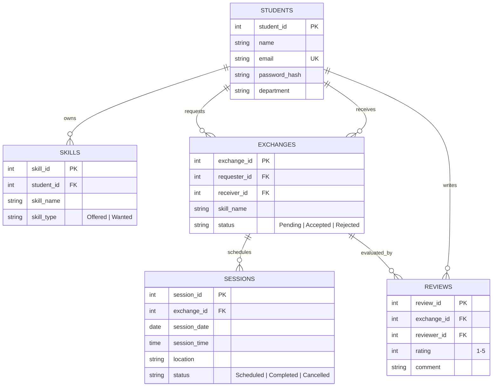

# 🎓 SkillShare – Campus Skill Exchange System

> *Share Skills. Learn Together. Grow Together.*

[](https://www.oracle.com/java/)
[](https://maven.apache.org/)
[](https://www.formdev.com/flatlaf/)
[](https://www.mysql.com/)
[](#license)

---

## 📌 Overview

**SkillShare – Campus Skill Exchange System** is a modern desktop application designed for college and university campuses. It allows students to exchange knowledge by teaching skills they have mastered and learning new skills from peers—fostering collaborative peer-to-peer learning without monetary barriers.

Built natively using **Java 21** and **Java Swing** with a modern **FlatLaf** theme, the system delivers an intuitive, fast, and responsive desktop experience backed by a robust MySQL relational database.

---

## ✨ Features

- **🔐 Student Authentication & Profiles**
  - Secure registration and login with SHA-256 password hashing.
  - Profile management displaying student details, department, and campus activity.
  - Active session handling throughout the app lifecycle.

- **📊 Dynamic Dashboard**
  - Instant metric cards showing total offered skills, wanted skills, active matches, and pending requests.
  - Upcoming scheduled learning sessions and quick-access action shortcuts.

- **💡 Skill Management**
  - **Offered Skills:** List skills you can teach to fellow students.
  - **Wanted Skills:** Specify skills you want to learn.
  - Add, search, and manage skill tags effortlessly.

- **🤝 Intelligent Skill Matching**
  - Algorithms that automatically find mutual and complementary skill matches between students.
  - Peer contact information and department details visible upon match.

- **📬 Exchange Requests Workflow**
  - Send direct exchange proposals to matching peers.
  - Accept, decline, and track pending and completed exchange requests in real time.

- **📅 Learning Sessions Scheduler**
  - Schedule in-person or campus study sessions (date, time, and campus location).
  - Track upcoming, completed, and canceled sessions.

- **⭐ Ratings & Reviews**
  - Leave structured 1–5 star ratings and written reviews after completed learning exchanges.
  - Build verified peer reputation on campus.

- **🎨 Modern Desktop UI**
  - Clean FlatLaf-powered dark/modern aesthetic with rounded cards, custom buttons, star rating bars, and fluid layout navigation.

---

## 🏗️ Architecture & Project Structure

The project follows a clean layered **MVC / DAO** architecture:

```
src/main/java/com/skillshare/
├── Main.java                      # Application entry point
├── config/
│   ├── AppConfig.java             # Multi-source configuration manager
│   └── DBConnection.java          # JDBC connection provider & table bootstrapper
├── dao/                           # Data Access Object layer (Raw JDBC & SQL)
│   ├── StudentDAO.java
│   ├── SkillDAO.java
│   ├── ExchangeDAO.java
│   ├── SessionDAO.java
│   └── ReviewDAO.java
├── model/                         # Plain Old Java Objects (Entities)
│   ├── Student.java
│   ├── Skill.java
│   ├── SkillMatch.java
│   ├── ExchangeRequest.java
│   ├── Session.java
│   └── Review.java
├── service/                       # Business logic & validations
│   ├── AuthService.java
│   ├── SkillService.java
│   ├── MatchingService.java
│   ├── ExchangeService.java
│   ├── SessionService.java
│   └── ReviewService.java
├── ui/                            # Java Swing Desktop Presentation Layer
│   ├── MainFrame.java             # Main application window & navigation
│   ├── auth/                      # Login & Registration dialogs/panels
│   ├── common/                    # Custom UI components (StatCard, UITheme, ModernButton...)
│   ├── dashboard/                 # Dashboard overview panel
│   ├── matches/                   # Find Matches view
│   ├── profile/                   # Student Profile view
│   ├── requests/                  # Exchange Requests view
│   ├── reviews/                   # Peer Reviews & Ratings view
│   ├── sessions/                  # Scheduled Sessions view
│   └── skills/                    # My Skills management view
└── util/                          # Shared utilities (Hashing, Dates, Validation)
```

---

## 🛠️ Technology Stack

| Component | Technology |
| :--- | :--- |
| **Language** | Java 21 |
| **Desktop GUI** | Java Swing + FlatLaf 3.5.4 |
| **Build & Dependency Tool** | Apache Maven |
| **Database** | MySQL 8.x |
| **Driver / Connectivity** | MySQL Connector/J 8.x |
| **Security** | SHA-256 Password Hashing + Salting |

---

## 🚀 Getting Started

### Prerequisites

Ensure you have the following installed on your machine:
- **Java Development Kit (JDK) 21** or higher: `java -version`
- **Apache Maven 3.8+**: `mvn -version`
- **MySQL Server** (running locally or remotely)

---

### 1. Database Setup

1. Open your MySQL client (CLI, MySQL Workbench, or DBeaver) and create the database:
   ```sql
   CREATE DATABASE campus_skill_exchange;
   ```
2. *Note:* You do **not** need to manually create tables—the application will automatically create all tables (`students`, `skills`, `exchanges`, `sessions`, `reviews`) on its first launch!

---

### 2. Configure Database Credentials

Configure your database connection in one of three ways:

#### Option A: `config.properties` file (Recommended)
Create a file named `config.properties` in the project root:
```properties
db.url=jdbc:mysql://localhost:3306/campus_skill_exchange?allowPublicKeyRetrieval=true&useSSL=false&serverTimezone=UTC
db.user=your_mysql_username
db.password=your_mysql_password
```

#### Option B: Environment Variables
Export environment variables in your terminal:
```bash
export CAMPUS_DB_URL="jdbc:mysql://localhost:3306/campus_skill_exchange?allowPublicKeyRetrieval=true&useSSL=false&serverTimezone=UTC"
export CAMPUS_DB_USER="your_mysql_username"
export CAMPUS_DB_PASSWORD="your_mysql_password"
```

#### Option C: `application.properties`
Edit `src/main/resources/application.properties`.

---

### 3. Build the Application

Compile and package the standalone executable JAR using Maven:

```bash
mvn clean package -DskipTests
```

This generates the executable JAR in the `target/` directory:
`target/skillshare-campus-1.0.0.jar`

---

### 4. Run the Application

#### Option 1: Direct JAR Execution
```bash
java -jar target/skillshare-campus-1.0.0.jar
```

#### Option 2: Using Maven
```bash
mvn exec:java
```

#### Option 3: Using Helper Scripts (macOS / Linux)
```bash
# Make executable if needed
chmod +x run.sh

# Run via script
./run.sh
```
*(On macOS, you can also double-click `SkillShare.command` to launch.)*

---

## 🗄️ Database Schema Overview



---

## 🤝 Contributing

Contributions are welcome!
1. Fork the Project
2. Create your Feature Branch (`git checkout -b feature/AmazingFeature`)
3. Commit your Changes (`git commit -m 'Add some AmazingFeature'`)
4. Push to the Branch (`git push origin feature/AmazingFeature`)
5. Open a Pull Request

---

## 📄 License

This project is licensed under the MIT License — see the [LICENSE](LICENSE) file for details.

